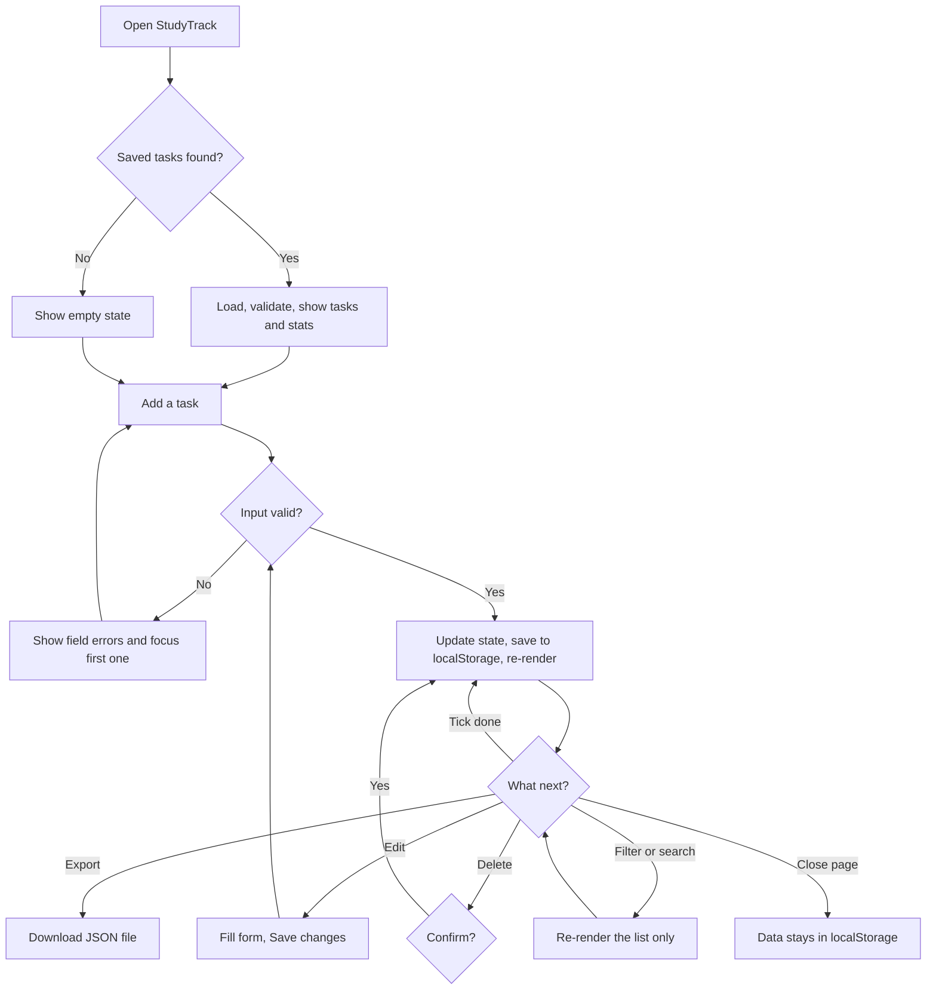

# StudyTrack: Wireframes and User Flow (Assignment 51)

## Mobile (360px, one column)
```
+----------------------------------+
| StudyTrack      [Export] [Dark]  |
+----------------------------------+
| +------+ +------+                |
| |  12  | |  7   |   (4 stat      |
| | Total| |Active|    cards in    |
| +------+ +------+    a 2x2 grid) |
| |  5   | |  2   |                |
| | Done |Overdue|                 |
| [#######-----] 42% complete      |
+----------------------------------+
| Add a task                       |
| Title    [__________________]    |
| Subject  [__________________]    |
| Due date [__/__/____] Priority[v]|
| [ Add task ]                     |
+----------------------------------+
| Your tasks                       |
| Search [________]                |
| Subject [All v]  Status [All v]  |
| +------------------------------+ |
| |[ ] Revise loops              | |
| | (Python) (High) Due 30 Oct   | |
| |            [Edit] [Delete]   | |
| +------------------------------+ |
| +------------------------------+ |
| |[x] Read ch.3 (done)          | |
| +------------------------------+ |
| [ Clear completed ]              |
+----------------------------------+
```

## Desktop (900px and wider, two columns)
```
+--------------------------------------------------------------+
| StudyTrack                                  [Export] [Dark]  |
+--------------------------------------------------------------+
| [Total 12] [Active 7] [Done 5] [Overdue 2]                   |
| [##########-------] 42% complete                             |
+-------------------------+------------------------------------+
| Add a task  (sticky)    | Your tasks                         |
| Title   [____________]  | Search [____] Subject[v] Status[v] |
| Subject [____________]  | [ ] Revise loops   (Python)(High)  |
| Due [____] Priority [v] |     Due 30 Oct          [Edit][Del]|
| [Add task]              | [ ] Practice DOM   (Web)(Medium)   |
|                         | [x] Read ch.3      (Maths) done    |
+-------------------------+------------------------------------+
| Footer: data is saved only in this browser                   |
+--------------------------------------------------------------+
```

## States to design
| State | What the user sees |
|-------|--------------------|
| Empty (first visit) | "No tasks yet. Add your first study task." |
| No search results | "No tasks match these filters." |
| Validation error | Red message under the field, field outlined, focus moves to it |
| Editing | Form heading "Edit task", button "Save changes", Cancel button, the task row outlined |
| Overdue | Red left border and "Overdue: 20 Oct 2026" |
| Storage unavailable | Message: changes last only until the tab is closed |

## User flow


## Text version of the main flow
1. Open the app. Saved tasks load and the stats are drawn.
2. Fill the form and press **Add task**. If something is wrong, errors appear. Otherwise the task is saved and shown.
3. Tick a task to mark it done. The progress bar updates.
4. Press **Edit** to change a task, or **Delete** to remove it (with a confirmation).
5. Use search and filters to narrow the list.
6. Close the tab. When you come back, everything is still there.
